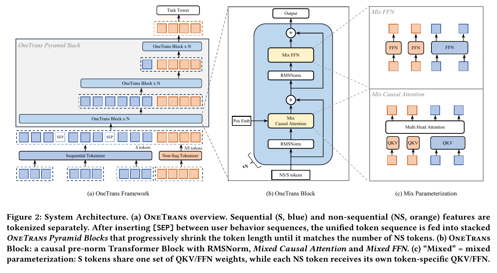

# OneTrans-S 昇腾 950DT 复刻报告（v6 第四稿）

> 数据基准：16 die（2 节点 × 8）· CANN 9.1.0 · torch 2.10.0 / torch_npu 2.10.0 · 2026-11-17
> 代码：`github.com/xiaomingyao/OneTrans-S`（上游 GPU 参考锁定 `8febd7e`）

## 1 范围和目的

**目的**：在昇腾 950DT 上复刻论文 arXiv:2510.26104v3 的 **OneTrans-S 训练**，实测步时、吞吐、显存与算力利用率，并与论文同规模平台并列比较。

**范围**：

| 项 | 本报告范围 |
|---|---|
| 训练 | ✅ 前向 + 反向 + 优化器，单步稳态（不含取数与 H2D） |
| 推理 | ❌ 不涉及（无 P99、无 cross-request KV cache、无在线服务） |
| 规模 | 16 die（2 节点 × 8），全局 batch 32,768，与论文 16 卡对齐 |
| 对照 | 论文 Table 4 的 5 档步时（407 / 290 / 284 / 203 / 273 ms，单点消融、百分比相对 407） |

## 2 OneTrans-S 模型架构

### 2.1 模型架构（论文 Figure 2 原图）



图中三层结构，自外向内：

1. **框架层（a）**：序列特征（S）与非序列特征（NS）各自 tokenize 后用 [SEP] 拼成一条序列，整体送入 Pyramid Stack，最后取尾部位置进 Task Tower。
2. **块层（b）**：标准 Pre-Norm 块 —— RMSNorm → Mix Causal Attention → 残差 → RMSNorm → Mix FFN → 残差。
3. **参数层（c）**：Mix 的含义是"按组走不同权重" —— 序列 token 共享一套 QKV/FFN，12 个 NS token **各有一套**（共 13 组）。

### 2.2 数据流

```
非序列特征 ──Non-Seq Tokenizer──→ 12 个 NS token ─┐
                                                  ├─ [SEP] + concat ──→ 1203 个位置
序列特征 ────Sequential Tokenizer─→ 1190 个 S token ┘                    │
                                                                        ↓
        ┌──────────── OneTrans Pyramid Stack（7 次 block-pass）──────────┐
        │  pass 1 (base) : query 1203，K/V 1203                        │
        │  stack0: 1203 → stack1: 960 → stack2: 736                    │
        │  stack3: 480  → stack4: 256 → stack5: 12                     │
        └──────────────────────────────────────────────────────────────┘
                                                                        ↓
                          取最后 12 个位置 → mean pooling → LayerNorm → Linear → sigmoid
```

| 环节 | 尺寸 | 说明 |
|---|---|---|
| 统一序列 | 1190 + 12 + 1 = **1203** | 1 个 [SEP] 分隔行为序列与 NS token |
| 逐层 query 长度 | 1203 → 1203 → 960 → 736 → 480 → 256 → **12** | 32 对齐的线性收缩，顶层 = NS 数 |
| K/V 长度 | 等于上一层的输出长度 | 掩码为**底右对齐因果**（`col ≤ row + (Lk − Lq)`） |

### 2.3 关键参数

| 项 | 值 | 项 | 值 |
|---|---|---|---|
| 宽度 d / 头数 H | 256 / 4（head_dim 64） | 层数 | "6 stacked"（实测口径对应 **7 次 block-pass**） |
| FFN 宽度 | 1536（= 6×d，SiLU×2） | 序列长度 | 1190 → 12 |
| NS token | 12（+[SEP] 1） | 参数量 | **91,026,946**（论文 91 M） |
| per-GPU batch | 2048（全局 32,768） | 精度 | bf16（论文基线 fp32） |
| 优化器 | AdamW(5e-3) | 梯度裁剪 | **未实现**（论文 dense 90 / sparse 120） |

### 2.4 论文性能与四项优化

> 论文原文（§4.1.2 脚注）："all-reduce on **16 H100 GPUs**"；全文无 A100 字样，故下表按原文标注 16 卡平台。

| 优化项 | 做了什么 | 论文训练步时（407 ms 基线上单点打开） | 显存 |
|---|---|---:|---:|
| 基线（无优化） | fp32、朴素注意力、全长序列 | **407 ms** | 53.13 GB |
| ① 金字塔压缩 Pyramid Stack | 逐层尾部截断：只让尾部 L 个位置做 query，L 从 1190 线性收到 12（32 对齐）；参数共享不变，纯算法改动 | **290 ms（−28.7%）** | 30.50 GB |
| ② Cross-request KV 缓存 | 跨请求复用历史 K/V，主要收益在推理侧（训练侧只省显存） | **284 ms（−30.2%）** | 22.10 GB |
| ③ FlashAttention-2 | 分块 + 在线 softmax，不再物化 S² 注意力矩阵 | **203 ms（−50.1%）** | 21.84 GB |
| ④ 混合精度 + 重算 | bf16 前反向 + 激活重算换显存，从而支撑 per-GPU batch 2048 | **273 ms（−32.9%）** | 27.10 GB |

**读法**：四行是**单点消融**（每行 = 407 ms 基线上单独打开该项），故 203 与 273 不构成先后关系；
**273 ms 是唯一与本仓同精度档（bf16 + 重算）的一行**，本报告以它为对标基准。

## 3 迁移适配

### 3.1 训练环境

| 项 | 值 |
|---|---|
| 加速器 | Ascend950DT_9582，**16 die = 2 节点 × 8**（122 + 111），1 die = 1 卡 |
| 软件栈 | CANN 9.1.0 · torch 2.10.0+cpu · torch_npu 2.10.0 · triton 3.2.0 · Python 3.12 |
| 单卡算力 | bf16 Cube **432 TF/s**（32 AI core × 1650 MHz；实测 412–429.8 TF = 95.4–99.5%） |
| 单卡显存 | 容器可见 **91.75 GiB/die**（标称 144 GB，差异待核） |
| 互连 | HCCL（RoCE + UB）；AllReduce 19.5 ms/步，暴露 4.7 ms（0.8%） |

### 3.2 代码适配（冒烟跑通所需，按五阶段）

基线：上游 `WestbrookLong/OneTrans_Pytorch`（单卡、无分布式、无任何 NPU 代码）。
**优化开关全关时与上游逐位等价**：949 个张量 key+shape 全等、前向输出 md5 相同、参数量 91,026,946 一致。

| 阶段 | 改动量 | 关键内容 |
|---|---|---|
| 一 环境与设备 | `npu_compat.py` 160 行 + 装配层 138 行 | ① device 增加 npu 分支；② 固定环境指纹四项（SoC / CANN / torch_npu / driver）；③ torchrun + DDP over HCCL 替代单卡脚本 |
| 二 稀疏特征与 Embedding | **0 行** | ① 本模型无稀疏表：91 M 参数全稠密、81 个张量、最大 5 MB；② `nn.Embedding`/`EmbeddingBag`/`torchrec` 三项命中数均为 0；③ 参数与上游逐位一致 |
| 三 注意力算子 | `main_pytorch.py` 9 行（env 开关） | ① SDPA 换成 `npu_fusion_attention`（aclnn FA v4）；② 注意 `atten_mask` 语义是 True=屏蔽（与 SDPA 相反）；③ 切 BSH 布局 + 底右因果（kernel 45→6、46.3→12.3 µs，logits 逐位相同） |
| 四 混合精度 | 0 行（走兼容层） | ① 冒烟用 autocast bf16 跑通；② loss 有限、梯度无 NaN/Inf；③ 显式 bf16 干路属优化阶段（§4.3） |
| 五 精度固化 | 新增 6 个测试脚本 | ① CPU golden 对拍三关：张量 1.49e-7、loss 差 5.96e-8、梯度最大绝对误差 4.88e-4（1 个 bf16 ULP）；② 三关全 PASS；③ 判据固化进 CI |

改动集中在装配层，占上游参考实现 1,233 行的 **5.4%（基础）/ 11.9%（含多卡）**；模型文件、损失、指标、数据管道 **全部 0 行改动**。

### 3.3 与论文实现对齐（结构层 / 训练层）

> 论文未开源代码，故「论文实现」按其文字规定逐项核对。完整的 14 模块实现对照（含算子改写与精度取证）见 `docs/IMPL_COMPARISON_PAPER_VS_REPO.md`。

**结构层**

| 项 | 论文 OneTrans-S | 本仓 | 判定 |
|---|---|---|---|
| 层数 | "6 stacked OneTrans blocks" | 1 base + 6 pyramid = **7 次 block-pass** | ⚠️ 表述歧义（论文 TFLOPs 也按 7 次才对得上 2.64 T） |
| d_model / heads | 256 / 4 | 256 / 4 | ✅ |
| FFN 宽度 | **未给** | 1536（= 6×d） | ⚠️ 推定（论文消融表 24 M 行交叉佐证） |
| 序列长度 | 1190 → 12，每层取 32 的倍数，顶层 = NS 数 | `[1203,960,736,480,256,12]` | ✅ |
| NS token / [SEP] | 12 / 有 | 12 / 有（总长 1203） | ✅ |
| 参数共享 | S 共享一套 QKV+FFN，每个 NS 各一套 | `kqv_list[13]` / `ffn_list[13]`，S 用第 12 组 | ✅ |
| 掩码 | 金字塔尾部截断 ⇒ 底右因果 | `paper_causal`：`col ≤ row + (Lk−Lq)` | ✅ |
| Pre-Norm / SiLU×2 | 是 | 是 | ✅ |
| 位置编码 | 图中标注，**未给形式** | **无可训练位置编码参数** | ⚠️ 未闭合 |
| 参数量 | 91 M（**含 sparse embedding**） | **91,026,946**（纯稠密，无稀疏表） | ✅ 数值 / ⚠️ 构成不同 |
| 计算量 | 2.6481 TFLOPs（nominal 6ND） | **2.6489 TFLOPs**（同口径，差 0.03%） | ✅（附 A） |

**训练层**

| 项 | 论文 | 本仓 | 判定 |
|---|---|---|---|
| 优化器 | **双优化器、无 weight decay**：sparse Adagrad(0.1, 1.0) / dense **RMSProp(lr=0.005)** | **AdamW(lr=5e-3, wd=0)** | ⚠️ 实质不同（不影响步时口径，影响收敛） |
| 梯度裁剪 | global grad-norm，**dense 90 / sparse 120** | **未实现** | ❌ 缺口 |
| per-GPU batch | 2048 + gradient accumulation | 2048（档 A，开重算） | ✅ |
| 分布式 | data-parallel，16 GPU all-reduce | DDP over HCCL，16 die（2 节点 × 8） | ✅ 同构 |
| 数据 | 工业全量特征 | 合成 token 常驻 device，步时不含取数与 H2D | ⚠️ 口径选择 |
| 精度 | 基线 fp32 / 优化档 BF16·FP16 + 重算 | bf16（档 A 含重算） | ✅ 对应优化档 |
| 框架 / 算子库 | **未披露** | CANN 9.1.0 + torch_npu 2.10 + FA v4 | 无可比 |

**差异清单**

| 类型 | 内容 | 能否闭合 |
|---|---|---|
| 结构差异 | tokenizer 规模：论文 Group-wise 变体省 13 M ⇒ 其 tokenizer 远重于本仓的 0.81 M | ❌ 论文未披露内部投影方式 |
| 训练差异 | 优化器不同（AdamW vs RMSProp/Adagrad）、**grad-norm clip 未实现** | ✅ clip 一行可补；优化器可换 |
| 口径差异 | 参数量含稀疏表 vs 纯稠密；层数 6 vs 7 pass | ⚠️ 已标注 |
| 本仓多出 | 8 个算子级开关（合计 −68.35%）、DDP、profiling 钩子 | 论文侧无对应 |

### 3.4 当前实现的算子与组件依赖

本仓在 950DT 上的每一步训练，实际落在下表这些算子/组件上（效率为 16 die 实测，`kernel_details.csv` 聚合）。

| 环节 | 使用的算子 / 组件 | 每步次数 | 实测效率或带宽 |
|---|---|---:|---|
| 序列/非序列投影 | `Mm_MatMulV3`（tokenizer 的 `nn.Linear`） | 2 | 与 GEMM 同族 |
| QKV 投影（13 组） | `BatchMatMul`（`NS_BMM=1` 时合成 bmm）/ 否则 `Mm_MatMulV3` | 21 | 86% 峰值 |
| 注意力 | `FlashAttentionScoreV4`（aclnn FA v4，BSH 布局） | 14 | 53.6% 峰值 |
| 注意力反向 | `FlashAttentionScoreGradV4` | 14 | 45.5% 峰值 |
| 注意力输出投影 | `Addmm_MatMulV3`（带 bias） | 14 | 86% 峰值 |
| FFN（13 组 × 2 层） | `Mm_MatMulV3` / `BatchMatMul`（`FULL_PROJ=1` 走全量投影 + 原地覆盖） | 152 | 86% 峰值 |
| 归一化 | `RmsNorm`（前向）/ `RmsNormGrad`（反向） | 28 / 28 | 1445 GB/s（未融合）/ 已到厂商最优 |
| 激活 | `Silu_Swish` / `SiluBackward` | 54 / 54 | 3178 GB/s（贴 HBM 峰值） |
| 残差与梯度累加 | `Add_AddAiCore` | 479 | 3222 GB/s（贴峰值） |
| bias 梯度 | `ReduceSum`（`F.linear` 的 `dy.sum(0)`） | 200 | 3189–3358 GB/s（贴峰值） |
| 布局搬运 / 重排 | `InplaceCopy_TensorMove` / `InplaceCopy_Transpose` | 236 / 241 | 110 µs / 48 µs 单次 |
| 缓冲清零 | `InplaceZero_ZerosLike` | 580 | 24 µs/次（下发受限） |
| 精度转换 | `Cast`（显式 bf16 干路后大幅减少） | — | — |
| 梯度同步 | HCCL `AllReduce` | 1 组 | 19.5 ms，暴露 4.7 ms |
| 优化器 | `torch.optim.AdamW(lr=5e-3, wd=0)` | 1 | — |
| 激活重算 | `torch.utils.checkpoint`（档 A 开启） | — | 显存 58.48 → 39.17 GB |
| 数据供给 | 合成 token **常驻 device**（`--source synth`） | — | 步时不含取数与 H2D |
| 硬件 | Ascend950DT_9582 · 16 die（2 节点 × 8）· CANN 9.1.0 · torch_npu 2.10.0 | — | — |

**未实现项（当前实现缺口）**

| 项 | 状态 | 说明 |
|---|---|---|
| global grad-norm clipping | 未实现 | `clip_grad_norm_` 在本栈已实测可用（total_norm 4054.7 → 裁到 90），补入不影响步时口径 |
| 稀疏 embedding 表 | 不使用 | 本仓非序列特征走稠密 `nn.Linear` 投影，无表查找、无 gather、无表优化器 |
| 跨请求 KV 缓存 | 不适用 | 训练任务无 request / 历史维度 |

**NS tokenizer 的三种后端（新增，默认仍为 linear）**

`ONETRANS_NS_BACKEND` 可选 `linear`（默认，连续特征走 `nn.Linear`）/ `ec`（torchrec `EmbeddingCollection`）/ `dynamic_emb`（RecSDK v2 `BatchedDynamicEmbeddingTablesV2`）；
后两者把每个 NS 位置当成一张表（`ns_len` 张 × `ns_rows` 行 × `d_model`），输入改为 id。
实现见 `OneTrans_NPU/ns_backend.py`，三者 forward 输出统一 `[B, ns_len, d_model]`。

冒烟结果（d=64 / 4 heads / ffn=256 / seq=128 / ns=4 / batch=8 / pyramid=2 / ns_rows=20,000，3 步实测）：

| 后端 | 表参数 | 是否进 `nn.Parameters` | 梯度形态 | 每步 |
|---|---|---:|---|---:|
| `linear`（默认） | 0 | — | 稠密 | 25.3–28.4 ms |
| `ec` | 5.12 M | **是**（故 dense 梯度 5.12 M×4 B/步） | dense | 27.3–29.9 ms |
| `dynamic_emb` | 5.12 M | 否（HKV 外部存储） | 无 dense 梯度（优化器融进反向） | 29.4–44.8 ms |

三种后端 loss 均正常下降（3 步从 0.73/0.66 降到 0.04/0.17），说明前反向与优化器路径都通。
大规模（12 表 × 100 万行 × 64 维、24,576 次查表/步）的专项对比见 `docs/ASSESS_EC_VS_DYNAMICEMB.md`：
**dynamic_emb 10.62 ms vs 原始 EC 18.09 ms（快 1.70×），且省掉 2.9 GiB/步的 dense 梯度**。

> 环境约束：`ec` / `dynamic_emb` 依赖 torchrec 1.2.0+npu 与 dynamic_emb v25.09，本机仅 RecSDK 环境（`/opt/buildtools/torch_v2_pt2.7.1`，torch 2.7.1）具备；
> `linear` 路径同时可在主环境（torch 2.10.0）跑。两套环境不可混跑。

## 4 性能优化

### 4.1 与论文开箱性能对比

| 口径 | 论文（16 卡） | 本仓（16 die） | 比值 |
|---|---:|---:|---:|
| **开箱（无任何优化）** | **407 ms**（fp32、朴素注意力、全长序列） | **1,942.1 ms**（显存 52.30 GB） | **4.77×** |

> 两者卡数同为 16、全局 batch 同为 32,768，故比值可直接读作"开箱差距 4.77 倍"。
> 差距集中在三处：逐 token 小算子过多（Cat 51.4 ms/步）、attention 走 SDPA 回退、norm 无融合。

### 4.2 Profiling TOP-DOWN（分级嵌套，点 ▶ 展开）

**分析过程**：① 读 `step_trace_time.csv` 的 Computing / Communication / Free 三列，先判定是否计算受限；
② 用**差分法**（全步 − `--no-backward`）拆前向与反向，避免把 CPU 入队窗口当成设备执行时间；
③ `kernel_details.csv` 按算子名家族聚合；④ 按 (name, shape) 聚合 TOP 单算子；⑤ 隔离探针复测单算子，区分"形状问题"与"调用问题"。

**效率口径（已统一，勿再引用旧数）**：`效率 = 解析 FLOPs ÷ (432 TF/s × 实测 ms)`，
FLOPs 用逐层形状解析值（与 `FlopCounterMode` 实测交叉验证，差 1.6%），attention 取**全矩形**（内核收到显式 mask，按最保守计）。

```tree
# 节点（点 ▶ 展开） | 算力类型 | 耗时 | 占全步 | 判据与瓶颈
L1 · 整步 | 混合 | 614.27 ms | 100% | 计算 605.5（98.6%）｜通信 19.5（暴露 4.7）｜空闲 4.1｜气泡 0 ⇒ 纯计算受限
  L2 · 前向 | 混合 | 164.2 ms | 26.7% | HBM 12.33 GB；GEMM + FA 占前向 64.8%
    L3 · GEMM（前向投影） | Cube | 58.9 ms | 9.6% | 86% 峰值（隔离 95%）⇒ 已接近硬件
    L3 · FA 前向 + 附属 | Cube | 47.5 ms | 7.7% | 53.6% 峰值（全矩形口径）
    L3 · SiLU | Vector | 22.5 ms | 3.7% | 3178 GB/s，贴 HBM 峰值
    L3 · RMSNorm | Vector | 15.6 ms | 2.5% | 1445 GB/s（峰值 45%），未融合
    L3 · Add | Vector | 12.4 ms | 2.0% | 3222 GB/s，贴峰值
    L3 · 搬运 / 重排 | Vector | 5.5 ms | 0.9% | 视图拷贝
    L3 · 其他 + Cast | Vector | 1.8 ms | 0.3% | —
  L2 · 反向 + 优化器 + 通信 | 混合 | 471.9 ms | 76.8% | 反向/前向 = 2.87×（理论约 2.0×）
    L3 · FA 反向 + 附属 | Cube | 139.7 ms | 22.7% | 45.5% 峰值 ⇒ 最大单块，也是最没打满的 cube 算子
    L3 · GEMM | Cube | 117.2 ms | 19.1% | 86% 峰值，含 weight-grad
    L3 · Add | Vector | 45.3 ms | 7.4% | 梯度累加，贴带宽
    L3 · 搬运 / 重排 | Vector | 40.8 ms | 6.6% | 拷贝插在 GEMM 之间
    L3 · SiLU 反向 | Vector | 34.0 ms | 5.5% | 贴带宽
    L3 · RMSNorm 反向 | Vector | 24.5 ms | 4.0% | 874 µs/次，已到厂商最优
    L3 · ReduceSum | Vector | 20.8 ms | 3.4% | 200 次，= F.linear 的 bias 梯度
    L3 · AllReduce | 通信 | 19.5 ms | 3.2% | 暴露仅 4.7 ms（0.8%）
    L3 · Zero | Vector | 14.0 ms | 2.3% | 580 次 × 24 µs，下发受限
    L3 · 其他 + Cast | Vector | 16.1 ms | 2.6% | —
  L2 · 全步 TOP 单算子（跨阶段口径） | 混合 | 13 个共 520.6 ms | 84.7% | 用于定位发起点
    L3 · FlashAttentionScoreGradV4 | Cube | 131.3 ms | 21.4% | 14 次 × 9.4 ms
    L3 · Mm_MatMulV3 | Cube | 108.6 ms | 17.7% | 152 次 × 714 µs
    L3 · Add_AddAiCore | Vector | 56.9 ms | 9.3% | 479 次 × 119 µs
    L3 · Addmm_MatMulV3 | Cube | 53.6 ms | 8.7% | 78 次 × 688 µs
    L3 · FlashAttentionScoreV4 | Cube | 41.0 ms | 6.7% | 14 次 × 2.9 ms
    L3 · SiluBackward | Vector | 33.9 ms | 5.5% | 54 次 × 628 µs
    L3 · InplaceCopy_TensorMove | Vector | 26.0 ms | 4.2% | 236 次 × 110 µs
    L3 · RmsNormGrad | Vector | 24.5 ms | 4.0% | 28 次 × 874 µs
    L3 · Silu_Swish | Vector | 22.6 ms | 3.7% | 54 次 × 418 µs
    L3 · ReduceSum | Vector | 21.1 ms | 3.4% | 200 次 × 105 µs
    L3 · RmsNorm | Vector | 15.6 ms | 2.5% | 28 次 × 556 µs
    L3 · InplaceZero_ZerosLike | Vector | 14.0 ms | 2.3% | 580 次 × 24 µs
    L3 · InplaceCopy_Transpose | Vector | 11.6 ms | 1.9% | 241 次 × 48 µs
  L2 · 瓶颈归因（可回收时间排序） | — | ≈ 115–155 ms | — | 五项独立估算，不可相加后与步时相除
    L3 · FA 反向 45.5% → 60% | Cube | ≈ 34 ms | — | 139.7 − 27.5 T/(432×0.60) = 33.6 ms；受 FA v4 内核限制
    L3 · cube∥vector 重叠 15% → 30% | — | ≈ 50 ms | — | 双流实测串行 2.192 → 并发 2.102 ms；需改执行形态
    L3 · vector 融合减字节 | Vector | ≈ 30–40 ms | — | 235.4 ms × 15% 字节（add+norm、silu 合并）
    L3 · 小算子碎片 | Vector | ≈ 30 ms | — | 580 Zero + 200 ReduceSum + 236 搬运 + 241 转置
    L3 · GEMM 效率 | Cube | ≈ 0 | — | 86% 已接近隔离水平（95%），无实质空间
```

> 读表说明：三条 L2 支路口径不同 —— 前向/反向是**阶段口径**（差分法），TOP 单算子是**跨阶段口径**（同一算子在前向与反向都出现，不重复计入阶段）；归因各项独立。耗时为 3 个稳态步的设备侧 kernel 之和（636.1 ms），故 L3 之和略大于 614.27 ms 的墙钟步时。
>
> **口径更正（自纠）**：早期版本曾写 cube「29.3% / 50.9%」、GEMM「277 TF/s = 64.3%」并据此得出「GEMM 一半算力在空转、可回收 54 ms」。这三个数的 FLOPs 分子口径互不一致（44.11 T / 76.6 T / 48.8 T），统一为解析值后（GEMM 65.6 T、FA 27.5+11.0 T、cube 合计 104.1 T）**GEMM 实际是 86.3%**，所谓"空转"不成立，该条可回收估算作废。

### 4.3 优化执行与收益表

| 优化大类 | 优化项 | 开关 | 单步 Δ | 累计步时 |
|---|---|---|---:|---:|
| 起点 | — | — | — | 1,942.1 ms |
| ⑤ 布局与内存组织 | NS 专有 QKV/FFN 由逐 token Linear 合成 bmm | `NS_BMM` | **−25.70%** | 1,442.9 ms |
| ⑤ 布局与内存组织 | 融合 `npu_rms_norm` 替代手写 norm 链 | `FUSED_NORM` | −14.85% | 1,228.6 ms |
| ⑤ 布局与内存组织 | 去 cat：预分配 + 原地写 | `CAT_INPLACE` | −9.48% | 1,112.1 ms |
| ① 金字塔压缩 | 结构内建，无运行期开关（开/关实测 1.68×，与论文 3.06× 口径未闭合） | — | — | — |
| ② Cross-request KV 缓存 | 不适用：训练任务无 request / 历史维度 | — | — | — |
| ③ FlashAttention | SDPA 内置 causal 替代显式 mask（仅 q_len == k_len 的层） | `SDPA_CAUSAL` | −5.06% | 847.3 ms |
| ③ FlashAttention | FA 切 BSH 布局（省转置） | `FA_BSH` | −2.81%（单算子 −31.7%） | 823.5 ms |
| ⑤ 布局与内存组织 | 全量投影 + 原地覆盖 NS 行 | `FULL_PROJ` | −11.13% | 753.0 ms |
| ⑤ 布局与内存组织 | 全量投影与 FA BSH 同开 | — | −3.05% | 730.0 ms |
| ④ 混合精度 + 重算 | 显式 bf16 干路（关 autocast） | `EXPLICIT_BF16` | **−15.79%** | **614.7 ms（−68.35%）** |

> 档 A（论文口径：每卡 2048 + 激活重算）同配置为 **752.0 ms / 显存 39.17 GB**；档 B（每卡 1024×2、无重算）= **614.7 ms / 58.48 GB**。
> 重算本身不提速，作用是让每卡 2048 放得下；④ 属**精度档变更**（`mean rel(Δg) = 0.61%`），不能与布局类混谈。

## 5 结论

### 5.1 复刻等效性

1. **代码等效**：优化开关全关时与上游 GPU 参考**逐位等价**（949 张量 key+shape 全等、前向 md5 相同、参数 91,026,946 一致）。
2. **结构对齐**：d=256 / H=4 / 7 次 block-pass / 混合参数化 / Pre-Norm / 底右因果 / per-GPU batch 2048 全对齐。
3. **计算量同口径**：论文 nominal 2.648 TFLOPs vs 本仓 2.6489 TFLOPs（差 0.03%）。
4. **4 处差异已标注**：梯度裁剪未实现、优化器不同（AdamW vs RMSProp）、FFN 宽度为推定值、层数表述歧义。

### 5.2 性能结论（档 B）

| 性能指标 | 本仓 | 论文 | 性能比（本仓 / 论文） |
|---|---:|---:|---:|
| 开箱 batch 耗时 | **1,942.1 ms** | 407 ms | 21.0% |
| 开箱显存峰值 | **52.30 GB** | 53.13 GB | 101.6% |
| 优化后 batch 耗时 | **614.7 ms** | 273 ms | **44.4%** |
| 优化后显存峰值 | **58.48 GB** | 27.10 GB | 215.8% |

说明：性能比按吞吐口径（论文耗时 ÷ 本仓耗时）；显存比为本仓 ÷ 论文（越小越好）。

### 5.3 理论分析（950DT 实测硬件参数与单 batch 耗时公式）

#### 5.3.1 950DT 硬件参数（本机实测）

| 参数 | 实测值 | 测法 |
|---|---:|---|
| Cube bf16 峰值 | **432 TF/s** | 32 AI core × 1650 MHz；实测 (8192,1024)@(1024,4096) = **412 TF/s（95.4%）**，大 M 形状 429.8（99.5%） |
| HBM 带宽 | **3.22–3.92 TB/s**（elementwise 实测 3.28–3.33） | 64M 元素 add：241.6 µs / 805 MB |
| HBM 容量 | **91.75 GiB**（容器可见） | npu-smi |
| L2 带宽 / 容量 | **5.1–7.7 TB/s**；容量 ≈ **192 MB**（工作集 201 MB 起掉速） | 同一 add 扫 1M→64M 的拐点 |
| Vector 元素级吞吐 | HBM 限 **3.3 TB/s ⇒ 等效 0.28 TFLOP/s**（fp32） | add 67M |
| 向量超越函数 | exp **≥ 962 Gexp/s**（16.8M 元素，L2 驻留）；HBM 驻留降到 **402 Gexp/s** | exp 扫描 |
| kernel 下发底 | **5.1–6.1 µs/次** | 1M 元素时延不随 N 变 |

> **"向量超越函数"是什么、关键吗**：指 exp / log / sqrt / rsqrt / sin / tanh 这类非多项式函数，由向量单元的特殊函数单元（SFU）计算，不在 cube 里。本模型里只出现在 SiLU 的 sigmoid 和 RMSNorm 的 rsqrt —— 实测这两个算子都**贴 HBM 带宽**（SiLU 3178 GB/s、RMSNorm 1445 GB/s），说明瓶颈是访存不是 SFU，**不关键**，故不再单列对比维度。

#### 5.3.2 单 batch 耗时模型

```
T_batch = T_cube + T_vec − η · min(T_cube, T_vec) + T_other

  T_cube  = Σ_f  FLOPs_f / (P_peak × η_f)     # 逐算子族，各自效率
  T_vec   = Bytes / BW_eff                     # 只由必需字节数决定
  η       = cube 与 vector 的重叠率（0=完全串行，1=完美重叠）
  T_other = 通信暴露 + 空隙 + 附属 kernel
```

**标定**（用实测三量）：`T_cube = 348.4`、`T_vec = 235.4`、`η ≈ 0`、`T_other = 30.9` ⇒ **348.4 + 235.4 + 30.9 = 614.7 ms** ✓ 与实测一致。

#### 5.3.3 推导 A：cube 下界 = 240.8 ms

逐族 FLOPs（单卡、batch 2048，d=256、F=1536、NS=12，7 次 block-pass）：

| 算子族 | 解析式（每样本） | 每步 FLOPs | 理想 ms @432 TF/s |
|---|---|---:|---:|
| GEMM 前向 | `Σ_blocks[3·2·(Lk−12)·d² + 3·2·12·d² + 2·Lq·d² + 2·(Lq−12)·d·F·2 + 12·2·d·F·2]` + tokenizer + head | 21.87 T | 50.6 |
| GEMM 反向 | 前向 × 2（grad_input + grad_weight） | 43.75 T | 101.3 |
| FA 前向 | `4·Σ(Lq·Lk)·d` | 10.98 T | 25.4 |
| FA 反向 | 前向 × 2.5（FA 反向的标准倍率） | 27.45 T | 63.5 |
| **合计** | — | **104.04 T** | **240.8** |

> 这一口径已与 `FlopCounterMode` 独立交叉验证（31.53 vs 解析 32.04 GFLOP/样本，差 1.6%）。
> 若注意力内核能按块跳过被屏蔽区，attention 项可降到 19.2 T，则 cube 下界降为 **207 ms**——这是唯一能压低 cube 下界的假设，尚无证据支持。

#### 5.3.4 推导 B：vector 下界 = 235.4 ms（830 GB）

用"实测 ms × 有效带宽"反推各类字节（有效带宽 3.53 TB/s，由 830 GB ÷ 235.4 ms 自洽得到）：

| 类 | 实测 ms | 反推字节 |
|---|---:|---:|
| Add | 57.7 | 190.4 GB |
| SiLU | 56.5 | 186.4 GB |
| 搬运 / 重排 | 46.3 | 152.8 GB |
| RMSNorm | 40.1 | 132.3 GB |
| ReduceSum | 20.8 | 68.6 GB |
| Zero | 14.0 | 46.2 GB |
| 其他 + Cast | 16.1 | 53.1 GB |
| **合计** | **235.4** | **830 GB** |

**这 830 GB 的构成**：7 次 block-pass × 每 pass 约 6 个激活张量 × 「写一次 + 读一次」= 12 次访存，
每个张量在 L=1203 时约 1.26 GB（1203 × 256 × 2 B × 2048 样本）。
⇒ 每 pass ≈ 15 GB，×7 ≈ 105 GB 是**激活主干**，剩余约 725 GB 来自 13 组的 FFN 中间态（1536 宽 = 6 倍激活）、
autocast 的 Cast、`Zero`/`ReduceSum`/`ViewCopy` 等附属访存。

**融合可压缩的空间**：把 add+norm、silu+proj、NS 组重排合并后，可把 830 GB 压到约 550–600 GB
⇒ `T_vec` 可降到 **156–170 ms**（这是 §4.2 归因里"vector 融合 30–40 ms"的来源，偏保守）。

#### 5.3.5 推导 C：重叠与通信

| 项 | 值 | 来源 |
|---|---:|---|
| AllReduce 总时长 | 19.5 ms | `step_trace_time` |
| 其中未掩盖（暴露） | 4.7 ms | 同表 |
| 空隙（Free） | 4.1 ms | 同表 |
| 附属 kernel（含在家族口径但非矩阵/非纯向量） | ≈ 22 ms | 636.1（kernel 求和）− 348.4 − 235.4 − 19.5 |
| **T_other** | **30.9 ms** | 614.7 − 348.4 − 235.4 |
| 实测重叠率 η | **≈ 0–15%** | 双流探针：串行 2.192 → 并发 2.102 ms |

#### 5.3.6 理论上限：三个平台/三种情形

| 情形 | cube | vector | η | 步时上限 |
|---|---:|---:|---:|---:|
| **950DT 绝对下界**（cube 100% + 完美重叠） | 240.8 ms | 235.4 ms | 100% | **271.7 ms** |
| 950DT 现实上界（家族效率取上限 86%/60%/60%，重叠 50%） | 324.3 ms | 235.4 ms | 50% | 472.9 ms |
| **950DT 现状**（实测） | 348.4 ms（69.2%） | 235.4 ms | ~0 | **614.7 ms** |
| **H100 绝对下界**（同字节、989.4 TF/s、3.35 TB/s） | 105.2 ms | 247.8 ms | 100% | **278.7 ms** |
| **论文 273 ms** | — | — | — | **= H100 下界的 98%** |

#### 5.3.7 三条判断

1. **平台不是瓶颈**：950DT 绝对下界 **271.7 ms** 与 H100 的 **278.7 ms** 基本持平 —— 本负载已被带宽主导，
   950DT 的 bf16 算力虽然只有 H100 的 43.7%，但 HBM 带宽相当（3.5 vs 3.35 TB/s），所以下界几乎一样。
2. **论文已贴极限**：273 ms ÷ 278.7 ms = **98%**，说明论文实现基本运行在其平台的绝对下界上
   （其字节数应略低于本仓的 830 GB，否则下界还会更高）。
3. **差距全部来自效率**：614.7 ÷ 271.7 = **2.26×**，可精确拆成两项 ——
   - cube 效率 69.2% ⇒ 多付 **107.6 ms**（348.4 − 240.8）
   - 重叠率 0% ⇒ 多付 **235.4 ms**（vector 完全没有被 cube 掩盖）

#### 5.3.8 达标 287 ms 的等价条件（反解）

| cube 效率 | T_cube | 串行总时 | 需要的 η |
|---|---:|---:|---:|
| 100% | 240.8 ms | 507.1 ms | **94%** |
| 90% | 267.6 ms | 533.9 ms | 105%（>100%，单靠重叠不可能） |
| 80% | 301.0 ms | 567.3 ms | 119%（不可能） |
| 69.2%（现状） | 348.4 ms | 614.3 ms | 139%（不可能） |

⇒ **287 ms 要求「cube 效率 ≥ 94% 且重叠 ≈ 100%」**（两者缺一不可）；
若同时把 vector 字节压到 80%（664 GB ⇒ 188 ms），则条件放宽为「cube 94% + 重叠 100%」仍成立，
即 **vector 融合只改变余量，不改变主约束** —— 主约束是 cube 效率与重叠率。

## 附 A 计算量口径（nominal vs actual）

| 口径 | 公式 | 本仓值 | 论文 |
|---|---|---|---:|
| **nominal（论文同口径，6ND）** | `6 × N × Σ(block-pass token)` = 6 × 91,026,946 × 4850 | **2.6489 TFLOP/样本** | 2.6481 TFLOP |
| **actual（按分组形状逐层累加）** | 逐层 QKV / FFN / attention 实际矩阵乘 | **40.91 GFLOP/样本**（83.8 TFLOP/卡/步） | 论文未给 |

**关系**：nominal 把全部 91 M 参数乘到每个位置，实际只用到 13 组参数中的 1 组 ⇒ **nominal = actual × 64.7**。
⇒ nominal 只能用于与论文同口径对齐，**不能当 MFU 分子**（否则得出"占峰值 1%"的假数）。

## 附 B 证据索引

| 结论 | 文件 / 提交 |
|---|---|
| 论文数字与口径（唯一真源） | `docs/TOPIC_ONETRANS_S.md` §1、§4.1 |
| 与上游逐位等价 | `tools/probes/compare_upstream_model.py`、`docs/MODEL_ALIGNMENT_AUDIT.md` |
| 五阶段迁移细节 | `docs/MIGRATION.md` |
| TOP-DOWN 分解与 ReduceSum 归因 | `docs/PROFILE_ROUND2_AFTER_OPT.md` §10–§11 |
| 优化收益逐项 A/B | `docs/OPT_ROUND1_RESULTS.md`、`README.md` §3.0 |
| 硬件参数（Cube/Vector/L2/下发底） | `tools/probes/probe_vec_scaling.py`、`probe_vec_compute.py` |
| 全部原始日志 | `results/`（A/B、profile、fp8/int8 探针） |
